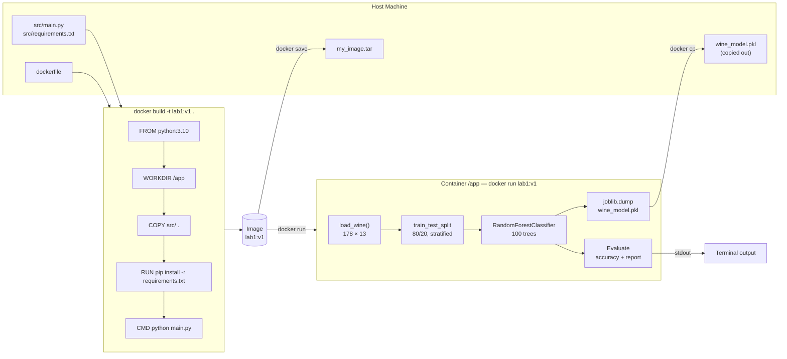

# LAB5 — Dockerized Wine Classifier


A containerized machine-learning training job: a **Random Forest classifier** trained on the **UCI Wine dataset**, packaged with Docker so it runs identically on any machine.

This is an implementation of [MLOps Docker Lab 1](https://github.com/raminmohammadi/MLOps/tree/main/Labs/Docker_Labs/Lab1) (IE7275), adapted from the Iris dataset to the Wine dataset, with model evaluation added.

---

## Table of Contents
- [Architecture](#architecture)
- [Dataset](#dataset)
- [Project Structure](#project-structure)
- [Prerequisites](#prerequisites)
- [Quick Start](#quick-start)
- [Expected Output](#expected-output)
- [Retrieving the Trained Model](#retrieving-the-trained-model)
- [How It Works](#how-it-works)
- [Changes vs. the Original Lab](#changes-vs-the-original-lab)
- [Useful Docker Commands](#useful-docker-commands)
- [Troubleshooting](#troubleshooting)

---

## Architecture



**Flow:** the `dockerfile` turns the source code into an image (`lab1:v1`). Running the image starts a container that loads the data, trains and evaluates the model, and writes `wine_model.pkl` inside the container. The image can be exported as a portable tar archive with `docker save`.

---

## Dataset

The [Wine recognition dataset](https://scikit-learn.org/stable/datasets/toy_dataset.html#wine-recognition-dataset) ships with scikit-learn (`sklearn.datasets.load_wine`), so no download is needed.

| Property | Value |
|---|---|
| Samples | 178 |
| Features | 13 continuous chemical measurements (alcohol, malic acid, ash, magnesium, flavanoids, proline, …) |
| Classes | 3 wine cultivars — `class_0` (59), `class_1` (71), `class_2` (48) |
| Task | Multi-class classification |

---

## Project Structure

```
LAB5_Docker/
├── dockerfile            # Image build recipe
├── README.md             # This file
├── .gitignore            # Ignores my_image.tar, *.pkl, __pycache__
└── src/
    ├── main.py           # Load data → train → evaluate → save model
    └── requirements.txt  # scikit-learn, joblib
```

---

## Prerequisites

- [Docker Desktop](https://www.docker.com/products/docker-desktop/) (or Docker Engine) installed **and running**
- ~2 GB free disk space for the image

Check that Docker is ready:

```bash
docker --version
docker info
```

---

## Quick Start

```bash
# 0. Clone the repository
git clone https://github.com/Aakash-2904/LAB5_Docker.git
cd LAB5_Docker

# 1. Build the image
docker build -t lab1:v1 .

# 2. Save the image to a portable tar archive
docker save lab1:v1 > my_image.tar

# 3. Run the container (trains + evaluates the model)
docker run lab1:v1
```

> To load the saved image on another machine: `docker load < my_image.tar`

---

## Expected Output

```
Test accuracy: 1.0000
              precision    recall  f1-score   support

     class_0       1.00      1.00      1.00        12
     class_1       1.00      1.00      1.00        14
     class_2       1.00      1.00      1.00        10

    accuracy                           1.00        36
   macro avg       1.00      1.00      1.00        36
weighted avg       1.00      1.00      1.00        36

The model training was successful
```

Perfect test accuracy is expected here: the Wine dataset is small and its classes are well separated, so the Random Forest classifies all 36 held-out samples correctly. Results are reproducible thanks to `random_state=42`.

---

## Retrieving the Trained Model

The model is saved **inside the container** at `/app/wine_model.pkl`. To copy it to your machine:

```bash
docker run --name wine_run lab1:v1
docker cp wine_run:/app/wine_model.pkl .
docker rm wine_run
```

Then load it in Python:

```python
import joblib
from sklearn.datasets import load_wine

model = joblib.load("wine_model.pkl")
X = load_wine().data[:5]
print(model.predict(X))   # [0 0 0 0 0]
```

> Load the model with the same scikit-learn version used in the container (1.7.x) to avoid compatibility warnings.

---

## How It Works

### `dockerfile`

| Instruction | Purpose |
|---|---|
| `FROM python:3.10` | Base image with Python 3.10 |
| `WORKDIR /app` | Sets the working directory inside the container |
| `COPY src/ .` | Copies the training script and requirements into `/app` |
| `RUN pip install --no-cache-dir -r requirements.txt` | Installs dependencies; `--no-cache-dir` keeps the image smaller |
| `CMD ["python", "main.py"]` | Runs training when the container starts |

### `src/main.py`

1. **Load** the Wine dataset → `X` (178 × 13), `y` (3 classes)
2. **Split** 80% train / 20% test, stratified by class, `random_state=42`
3. **Train** a `RandomForestClassifier(n_estimators=100, random_state=42)`
4. **Evaluate** on the test set → accuracy + precision / recall / F1 per class
5. **Save** the model with `joblib.dump` → `wine_model.pkl`

### Tested environment

| Component | Version |
|---|---|
| Python (container) | 3.10.22 |
| scikit-learn | 1.7.2 |
| joblib | 1.6.0 |
| Docker | 28.5.1 |
| Image size | ~1.9 GB (tar ≈ 464 MB) |

---

## Changes vs. the Original Lab

| | Original Lab 1 | This Implementation |
|---|---|---|
| Dataset | Iris (150 × 4) | **Wine (178 × 13)** |
| Split | Random 80/20 | **Stratified** 80/20 |
| Evaluation | None | **Accuracy + classification report** |
| Model file | `iris_model.pkl` | `wine_model.pkl` |
| pip install | default | `--no-cache-dir` (smaller image) |

---

## Useful Docker Commands

| Command | Description |
|---|---|
| `docker images` | List local images |
| `docker ps -a` | List all containers (running and stopped) |
| `docker run --rm lab1:v1` | Run and auto-remove the container afterwards |
| `docker run -it lab1:v1 bash` | Open a shell inside the image |
| `docker rm <container>` | Remove a stopped container |
| `docker rmi lab1:v1` | Remove the image |
| `docker load < my_image.tar` | Restore the image from the tar archive |

---

## Troubleshooting

| Problem | Fix |
|---|---|
| `error during connect ... dockerDesktopLinuxEngine` | Docker Desktop isn't running — start it and wait until `docker info` succeeds |
| `failed to read dockerfile` | Run `docker build` from the repo root, where `dockerfile` lives |
| `my_image.tar` is huge | It is ~464 MB and is git-ignored on purpose — don't commit it |
| scikit-learn `InconsistentVersionWarning` when loading the model | Use scikit-learn 1.7.x on the host, or load the model inside the container |

---

## References

- [MLOps Docker Lab 1 — Ramin Mohammadi](https://github.com/raminmohammadi/MLOps/tree/main/Labs/Docker_Labs/Lab1)
- [scikit-learn Wine dataset](https://scikit-learn.org/stable/modules/generated/sklearn.datasets.load_wine.html)
- [Dockerfile reference](https://docs.docker.com/reference/dockerfile/)
